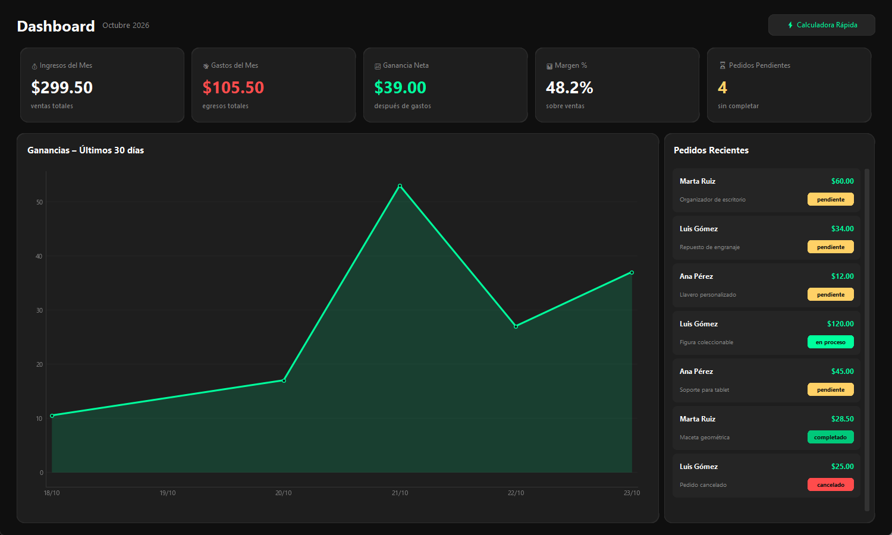
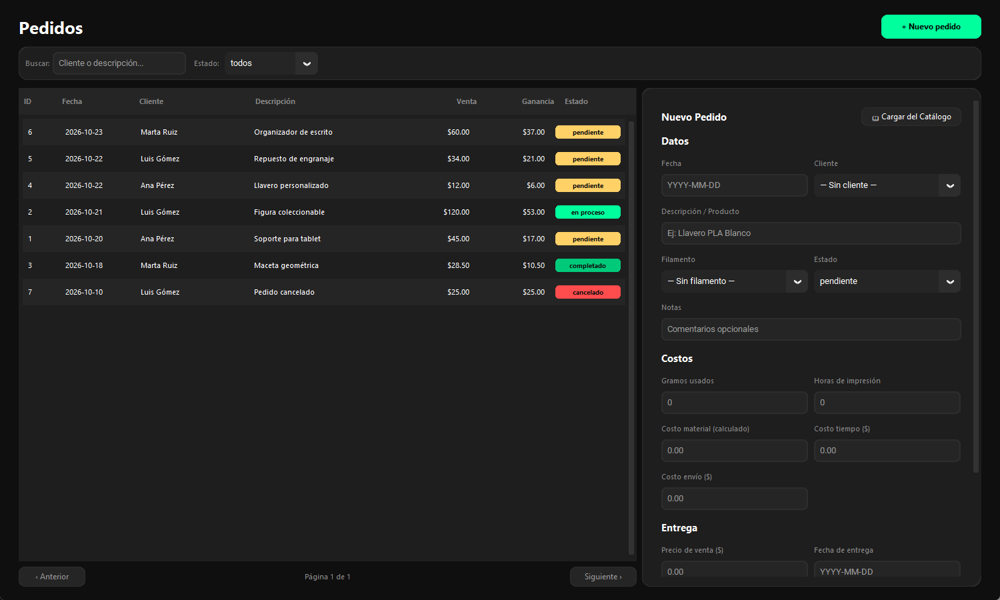
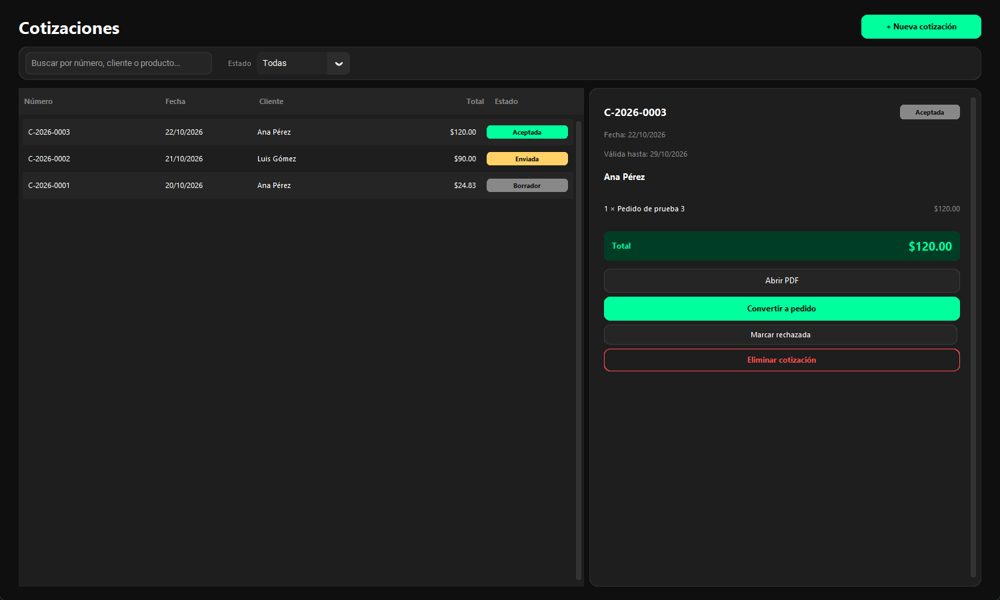
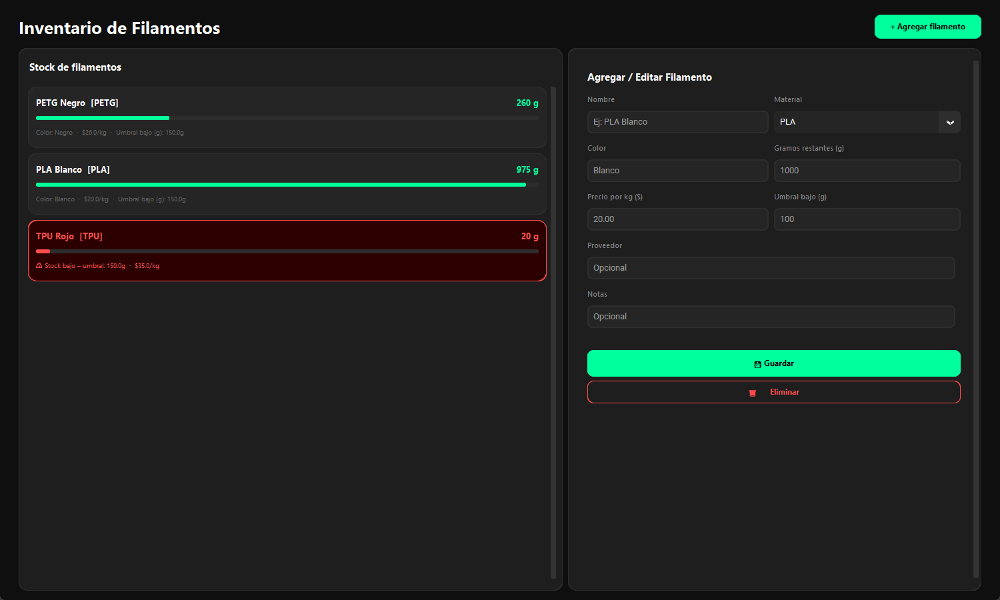
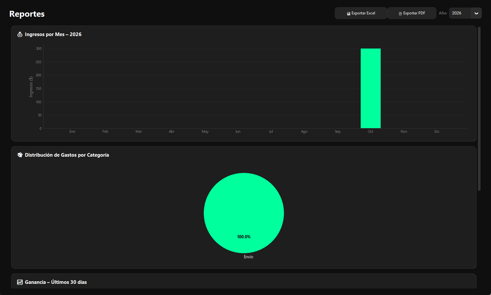
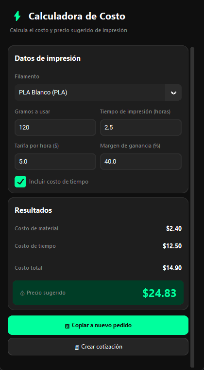
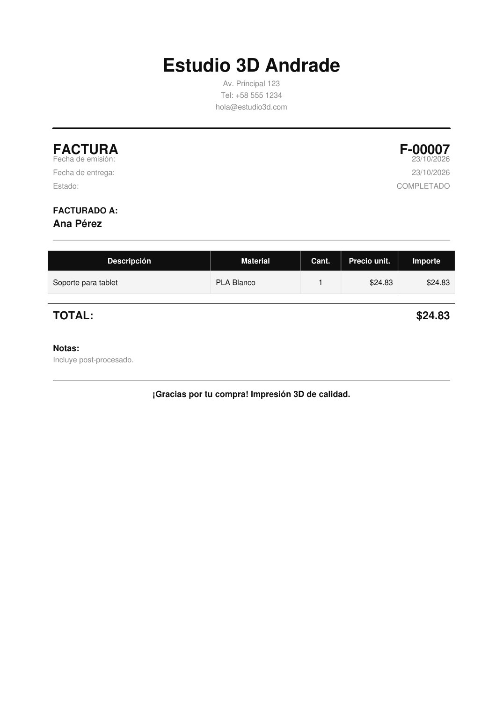

# PrintMoney 🖨️💰

<div align="center">

[](https://github.com/cibi-dev/print-money/blob/main/LICENSE)
[](https://www.python.org/)
[](https://github.com/TomSchimansky/CustomTkinter)
[-003B57?logo=sqlite&logoColor=white)](https://www.sqlite.org/)
[](https://www.microsoft.com/windows)
[](#-testing--quality-assurance)

**A sleek, production-ready desktop business management suite tailored for 3D printing services and maker studios.**

[Features](#-core-features) • [Architecture](#-architecture--engineering-highlights) • [Screenshots](#-visual-tour) • [Quickstart](#-quickstart--developer-setup) • [Download](#-download-windows-build) • [Contributing](#-contributing)

<br/>



</div>

---

## 💡 Overview

Managing a custom 3D printing enterprise involves intricate job costing (spool depreciation, machine runtime, electrical draw, failure allowances), fast-paced client inquiries, recurring overhead, and tight delivery schedules.

**PrintMoney** centralizes your entire operation into a single high-performance desktop application:
- Real-time gross margin & profitability tracking per print job.
- Complete quote-to-order pipeline with automated vector PDF invoice generation.
- Dynamic filament inventory ledger with consumption logging and low-stock alerts.
- Client CRM, delivery calendar, recurring overhead tracker, and comprehensive analytical reports.

---

## 📸 Visual Tour

<div align="center">

### 📦 Orders & Quote Management
<table>
  <tr>
    <td width="50%">
      
      <p align="center"><b>Order Lifecycle & Cost Tracking</b><br/><sub>Status pipeline, automatic filament deduction, and margin indicators</sub></p>
    </td>
    <td width="50%">
      
      <p align="center"><b>Quote History & 1-Click Conversion</b><br/><sub>Draft estimates, track acceptance states, and convert directly into live jobs</sub></p>
    </td>
  </tr>
</table>

### 🧵 Inventory & 📈 Business Analytics
<table>
  <tr>
    <td width="50%">
      
      <p align="center"><b>Filament Spool Management</b><br/><sub>Per-material tracking (PLA, PETG, ABS), cost per gram, and stock thresholds</sub></p>
    </td>
    <td width="50%">
      
      <p align="center"><b>Financial Analytics & Reporting</b><br/><sub>Monthly revenue distribution, expense categorization, and Excel/PDF export</sub></p>
    </td>
  </tr>
</table>

### ⚡ Instant Cost Calculator & Invoicing
<table>
  <tr>
    <td width="35%">
      
      <p align="center"><b>Floating Quick-Cost Calculator</b><br/><sub>Calculate grams + machine hours + markup on the fly</sub></p>
    </td>
    <td width="65%">
      
      <p align="center"><b>Professional Vector PDF Invoices & Quotes</b><br/><sub>Generated with ReportLab: client breakdown, tax compliance, and payment terms</sub></p>
    </td>
  </tr>
</table>

</div>

---

## ⚙️ Core Features

| Module | Capabilities |
|---|---|
| 📊 **Executive Dashboard** | Monthly revenue, job profit, operating expenses, and interactive revenue vs cost graphs. |
| 📦 **Order Management** | Complete lifecycle CRUD (`pending`, `in_progress`, `completed`, `cancelled`), cost breakdown (material + machine runtime), and auto-deduction of filament. |
| 🧾 **Quotes & Estimation** | Create quick customer estimates, export formatted PDF/text quotes, and convert accepted quotes into active orders with one click. |
| 🧵 **Filament Inventory** | Multi-brand spool tracking, weight logging, material cost calculations, and visual low-stock warning banners. |
| 💸 **Expense Tracker** | Categorized expense bookkeeping with recurring overhead support (electricity, shop rent, maintenance). |
| 👥 **Client CRM** | Comprehensive client registry, order history, lifetime value (LTV), and contact metadata. |
| 📋 **Product Catalog** | Saved print templates with preset weights and printing times for rapid order creation. |
| 📅 **Delivery Calendar** | Interactive calendar highlighting upcoming job deadlines to prevent production bottlenecks. |
| ⚡ **Cost Calculator** | Floating widget computing total print price from filament weight, machine hours, labor, and profit margins. |
| 🌐 **Bilingual (i18n)** | Instant runtime switching between **Spanish** and **English** with zero state loss. |

---

## 🏛️ Architecture & Engineering Highlights

PrintMoney was built with emphasis on resilience, UX fluidity, and data integrity:

```
┌────────────────────────────────────────────────────────┐
│               CustomTkinter UI Layer                   │
│   (Stacked Grid Zero-Flicker Layout • Theme Engine)    │
└───────────────┬────────────────────────┬───────────────┘
                │                        │
       (Main Thread Calls)      (Worker Thread Spawn)
                │                        │
                ▼                        ▼
┌──────────────────────────────┐ ┌───────────────────────┐
│     SQLite DB Manager        │ │  Background Workers   │
│ • WAL Journal Mode           │ │ • PDF Generation     │
│ • ACID Transactions          │ │ • Excel Aggregations  │
│ • Schema Migrations          │ │ • Toast Notifications │
└───────────────┬──────────────┘ └───────────┬───────────┘
                │                            │
                ▼                            ▼
┌────────────────────────────────────────────────────────┐
│                  Resilient Storage                     │
│ • Atomic JSON Writes (Write-then-Rename)               │
│ • Multi-tier Windows Path Resolver (%APPDATA% Fallback)│
│ • Daily Automated DB Backups                           │
└────────────────────────────────────────────────────────┘
```

### 1. Zero-Flicker View Transitions (Stacked Grid)
Standard `pack()` / `forget()` navigation in Tkinter causes noticeable geometry recalculation and widget bleeding. PrintMoney implements a **Stacked Grid pattern**: all primary views are anchored to the same master grid coordinates `(0, 0)`. Transitions use `grid_remove()` and geometry signature caching to swap views in <5ms without screen flickering or redraw glitches.

### 2. Thread-Safe Background Workers
PDF invoice compilation (via ReportLab) and multi-year analytical exports are delegated to dedicated background worker threads (`threading.Thread`). The Tkinter main loop is never blocked, keeping the desktop UI responsive at 60 FPS. Results and UI notifications are marshaled back to the main thread safely via `self.after()`.

### 3. Fault-Tolerant Atomic I/O
To eliminate the risk of corrupted application configurations or state files during sudden machine shutdowns or power loss:
```python
# utils/atomic_io.py: Write to temporary file on same volume, then atomic rename
with open(temp_file, "w", encoding="utf-8") as f:
    json.dump(data, f, indent=4)
os.replace(temp_file, target_file)
```

### 4. Smart Multi-Tier Windows Data Path
The app complies with Windows User Experience guidelines by keeping application binaries and mutable user data strictly segregated:
1. Primary: `%APPDATA%\PrintMoney\` (Roaming user profile).
2. Fallback: `%LOCALAPPDATA%\PrintMoney\` (If roaming directory permissions are restricted).
3. Portable: `./PrintMoneyData/` (Adjacent to binary if portable mode is desired or environment variable `PRINTMONEY_DATA_DIR` is set).

### 5. High-Concurrency SQLite Engine
- Configured with `PRAGMA journal_mode = WAL` (Write-Ahead Logging) and `PRAGMA synchronous = NORMAL`.
- Connections are encapsulated in Python context managers with guaranteed rollback on unhandled exceptions and immediate descriptor cleanup.
- Safe schema migration pipeline (`_migrar_esquema`) maintaining backwards compatibility with historical user databases.

---

## 📁 Repository Structure

```
print-money/
├── .github/                   # Workflows & issue/PR templates
├── assets/
│   ├── icons/                 # UI vector icons (Feather icons)
│   └── screenshots/           # Curated application showcase images
├── docs/
│   ├── internal/              # Engineering specifications & security audit logs
│   └── plans/                 # Architectural decision records and milestones
├── scripts/                   # Build and maintenance scripts
│   ├── build.ps1              # PyInstaller executable build script
│   ├── build.bat              # Batch wrapper for Windows
│   └── reparar_inventario.py  # Inventory consistency repair utility
├── tests/                     # Automated test suite (87 tests)
│   ├── test_atomic_io.py      # File safety & atomicity unit tests
│   ├── test_regression.py     # Business logic & CRUD regression tests
│   └── test_ui_smoke.py       # CustomTkinter headless smoke tests
├── ui/                        # Presentation Layer (CustomTkinter views)
│   ├── dashboard.py           # KPIs, metrics, and monthly overview
│   ├── orders.py              # Order management and workflow
│   ├── quotes.py              # Quote creation, PDF generation & conversion
│   ├── inventory.py           # Filament stock tracking & alerts
│   ├── expenses.py            # Expense categorization & recurring costs
│   ├── clients.py             # Client CRM and history
│   ├── catalog.py             # Product catalog templates
│   ├── reports.py             # Matplotlib charts & data tables
│   ├── calendar.py            # Delivery calendar view
│   ├── calculator.py          # Quick cost estimator widget
│   ├── settings.py            # Preferences, backup & shop info
│   └── theme.py               # Palette colors & design tokens
├── utils/                     # Business Logic & Infrastructure
│   ├── atomic_io.py           # Atomic JSON write operations
│   ├── export.py              # Excel (.xlsx) / PDF report generators
│   ├── i18n.py                # Dictionary-based translation system (ES/EN)
│   ├── notifications.py       # Windows Toast notifications wrapper
│   ├── paths.py               # Robust AppData path resolution
│   └── pdf_invoice.py         # ReportLab PDF invoice rendering engine
├── db_manager.py              # SQLite schema, migrations & CRUD operations
├── main.py                    # Application bootstrap, navigation & window manager
├── requirements.txt           # Core runtime dependencies
├── requirements-build.txt     # Packaging dependencies (PyInstaller)
├── CHANGELOG.md               # Version history
├── CODE_OF_CONDUCT.md         # Community standards
├── CONTRIBUTING.md            # Contribution guidelines & standards
├── LICENSE                    # MIT License
└── SECURITY.md                # Vulnerability disclosure policy
```

---

## 🚀 Quickstart & Developer Setup

### Prerequisites
- **Windows 10 / 11**
- **Python 3.10+**
- Git

### 1. Clone & Set Up Virtual Environment

```powershell
# Clone the repository
git clone https://github.com/cibi-dev/print-money.git
cd print-money

# Create virtual environment
python -m venv venv
.\venv\Scripts\activate

# Install dependencies
pip install -r requirements.txt
```

### 2. Run the Application

```powershell
python main.py
```

---

## 🧪 Testing & Quality Assurance

PrintMoney includes a comprehensive 87-test suite that runs headlessly in memory without mutating production databases:

```powershell
# Run the complete test suite via unittest discovery
python -m unittest discover -s tests -p "test_*.py"
```

```
......................................................................
Ran 87 tests in 34.122s

OK
```

- **Data Integrity Tests**: Validates ACID transaction boundaries, annual profit calculations, and cancellation exclusions.
- **Atomic I/O Tests**: Asserts write-replace atomicity and data persistence across simulated write interrupts.
- **i18n Coverage**: Ensures 100% key parity between English and Spanish language dictionaries.
- **UI Smoke Tests**: Executes view instantiation and event handler bindings without display artifacts.

---

## 📦 Packaging (Build Standalone .exe)

To produce an independent Windows binary that runs on machines without Python installed:

```powershell
# Install build dependencies
pip install -r requirements-build.txt

# Run the build script
.\scripts\build.ps1
```

The compiled standalone application will be generated in `dist\PrintMoney\` with all assets, icons, and themes bundled.

---

## 🤝 Contributing

Contributions, issues, and feature requests are welcome!  
Please read our [Contributing Guidelines](CONTRIBUTING.md) and [Code of Conduct](CODE_OF_CONDUCT.md) before submitting a Pull Request.

---

## 📄 License

This project is licensed under the MIT License - see the [LICENSE](LICENSE) file for details.
